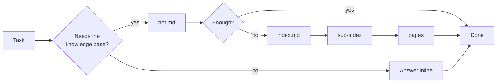
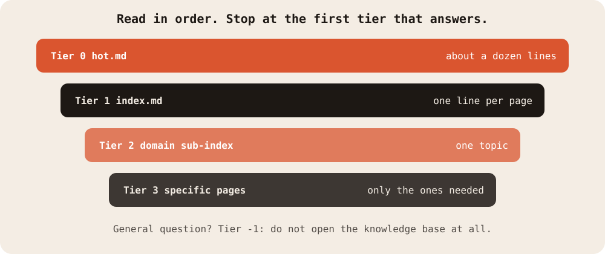
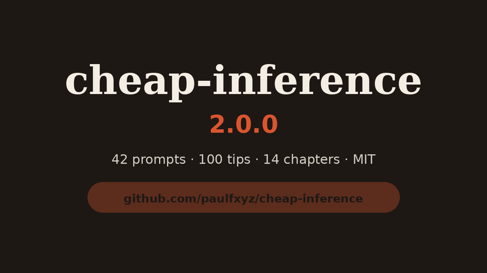
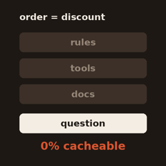
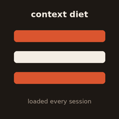

<div align="center">


<br>

# cheap-inference <sub>2.1.0</sub>

### Pay for the tokens that change the answer.

A tested, zero-dependency Python toolkit (34 tools, 8 workflows) and a 17-chapter field guide, reviewed by four frontier models, for cutting what you spend on language models. Load less. Redo less. Check with code. Route cheap first. Fan out with summaries.

<br>

<a href="https://github.com/paulfxyz/cheap-inference/actions/workflows/ci.yml"></a>
<a href="LICENSE"></a>


<a href="https://github.com/paulfxyz/cheap-inference/releases/tag/v2.1.0"></a>
<a href="https://github.com/paulfxyz/cheap-inference/stargazers"></a>

<br><br>

[**Quick start**](#quick-start) &nbsp;·&nbsp; [**The five levers**](#the-five-levers) &nbsp;·&nbsp; [**Tools**](#the-tools) &nbsp;·&nbsp; [**Field guide**](#the-field-guide) &nbsp;·&nbsp; [**Prompts**](docs/11-prompt-library.md) &nbsp;·&nbsp; [**154 tips**](docs/12-tips-and-tweaks.md) &nbsp;·&nbsp; [**Workflows**](docs/17-workflows.md) &nbsp;·&nbsp; [**Review**](docs/15-multi-model-review.md) &nbsp;·&nbsp; [**Receipts**](docs/14-claims-and-receipts.md)

</div>

<br>

## The short version

Most of what you pay a model for is not your question. It is the guide loaded in every session, the knowledge base opened for a question that never needed it, the 500 files re-read because nothing remembered they were done, the review pass a script could have done for free, and the premium model used to rename a file.

This repository attacks that waste with habits, templates and small Python tools. **None of the checks needs a model to run.** Every tool is a single, heavily commented file you can read in ten minutes.

> **One line to remember:** *if code can do it, never pay a model to do it.*

<br>

## Bold claims, with receipts

Every claim below has a command that checks it. Run them. If one fails for you, open an issue. Full list in [chapter 14](docs/14-claims-and-receipts.md).

<table>
<tr>
<td width="33%" valign="top">

### 0 tokens
The 34 tools never call a model or the network, so every check is free. Repairing what a check finds still costs what it costs.

<sub>Receipt: `python -m unittest tests.test_tools.NoNetworkTests` fails on any network import.</sub>

</td>
<td width="33%" valign="top">

### 1 false quote, caught
A planted lie passes a model reviewer more often than you would think. A 10-rule script catches it in milliseconds.

<sub>Receipt: `kb.py --root examples/broken-kb lint`</sub>

</td>
<td width="33%" valign="top">

### 0 cost on quiet nights
Hash every source. When nothing changed, the nightly job exits before any model call.

<sub>Receipt: `kb.py status` prints nothing.</sub>

</td>
</tr>
<tr>
<td valign="top">

### 1 line, whole cache
One timestamp at the top of a prompt can zero your cache hit rate. Order is the discount.

<sub>Receipt: `python tools/cache_sim.py`</sub>

</td>
<td valign="top">

### Monthly, not once
Always-loaded files are billed on every session. The budget checker prints the monthly loading bill.

<sub>Receipt: `python tools/budget.py examples/budget.json`</sub>

</td>
<td valign="top">

### 0 dependencies
Python standard library only. Clone, run, read. Nothing to install, nothing to trust.

<sub>Receipt: imports in `tools/`.</sub>

</td>
</tr>
</table>

<div align="center">

</div>

<br>

## Quick start

```bash
git clone https://github.com/paulfxyz/cheap-inference.git
cd cheap-inference

python tools/tokens.py templates/AGENTS.md templates/hot.md        # what does my context weigh?
python tools/budget.py examples/budget.json                        # does it fit, and what is the monthly bill?
python tools/prompt_lint.py templates/AGENTS.md                    # filler, volatile lines, eager imports
python tools/kb.py --root examples/broken-kb lint                  # a lie, caught for free
python tools/router.py "deep research on every competitor"         # which rung of the ladder?
python tools/cache_sim.py                                          # why prompt order is a discount
python tools/session_budget.py --turns 60 --per-turn 700           # when to start a fresh session
python -m unittest discover -s tests -v                            # 30 tests
```

<details>
<summary><strong>What the linter prints on the broken example</strong></summary>

```
wiki/lonely.md: frontmatter lacks 'updated'
wiki/lonely.md: source raw/gone.md does not exist
wiki/lonely.md: unresolved TODO/FIXME
wiki/memex.md: broken link [[nonexistent-page]]
wiki/memex.md: QUOTE NOT IN SOURCE -> "The memex was first built in 1975" (raw/memex.md)
wiki/lonely.md: orphan (no inbound links)
wiki/memex.md: orphan (no inbound links)
lint: 7 problem(s) in 2 pages
```

</details>

<br>

## How it works: a five-minute walkthrough

Follow one imaginary week to see how the pieces fit. Every number below comes from a tool you can run.

**Monday: measure.** Your project guide is 223 tokens and your hot cache is 32. `budget.py` multiplies that by 300 sessions a month and prints `~76,500 tokens/month` of pure loading. Nothing is wrong yet; you now have a baseline.

**Tuesday: trim.** `prompt_lint.py` flags a date at the top of the guide (it breaks caching), five filler phrases, a repeated rule and an eager `@wiki/index.md` import. You fix all four. The guide shrinks and the first lines become stable, so a provider that supports prompt caching can reuse them.

**Wednesday: stop re-reading.** You point `kb.py` at your notes. `kb.py status` lists only the two files that changed since the last ingest. The model reads those two, writes pages with quote lines, and `kb.py lint` checks every quote word for word. One planted false quote is caught in milliseconds, for 0 tokens.

**Thursday: route.** A bulk job arrives: 400 strings to translate. `router.py --items 400` says rung 4, fan-out. `costcalc.py` (with your own prices) shows the spread between a small model, a batch route and a premium model. You pick the cheap one and add a validator.

**Friday: look at the bill.** You export usage and run `usage_report.py`. One task is 72% of all tokens with a 0% cache rate. That is next week's work: reorder its prompt stable-first.

The loop is always the same: **measure, trim, check, route, review.** The tools are small on purpose so you can read each one and adapt it.

<br>

## The five levers



| | Lever | In one sentence | Chapter | Tool |
| :-: | --- | --- | :-: | --- |
| 1 | **Load less** | Read a hot cache, then an index, then pages. Stop at the first tier that answers. | [2](docs/02-tiered-loading.md) | `budget.py` `tokens.py` |
| 2 | **Redo less** | Hash sources; process only NEW, CHANGED, DELETED. | [5](docs/05-incremental-ingest.md) | `kb.py status` |
| 3 | **Check with code** | Quotes, links, orphans, staleness: all verified by script. | [4](docs/04-deterministic-checks.md) | `kb.py lint` `dedup.py` |
| 4 | **Route cheap first** | Lowest rung that can do it; climb with a reason. | [6](docs/06-routing-ladder.md) | `router.py` `ladder_log.py` |
| 5 | **Fan out with summaries** | One cheap worker per source, three lines back, one fresh verifier. | [7](docs/07-fan-out.md) | prompts P21 to P24 |

<div align="center">

</div>

### 1. Load less

Add one sentence to every guide: *do not open the knowledge base for general questions.* Keep a hot cache under a dozen lines. Never import big files eagerly: an import costs as much as pasting the file in.

<div align="center">

</div>

### 2. Redo less

The manifest records which source became which pages, at which hash. Cost follows what changed, not how big the vault is.

<div align="center">

</div>

### 3. Check with code

A model reviewing its own work tends to agree with itself. A script cannot be talked out of a rule. Ten rules, zero tokens, exit code 2 that a hook can feed straight back to the model.

### 4. Route cheap first

<div align="center">

</div>

Rung 0 is an inline answer. Rung 5 is a premium model. The rule: **climb one rung at a time, and only when you can say what failed.** Explicit instructions always win.

### 5. Fan out with summaries

Forty documents in the main thread are paid for on every later turn. Forty workers returning three lines each are not.

<br>

## The tools

Thirty-four single-file tools in [`tools/`](tools/). Standard library only. Every function documented. Every tool has tests. The first 13 are the foundation; the 21 marked new in 2.1.0 come from a [four-model review](docs/15-multi-model-review.md) and are explained in [chapter 16](docs/16-advanced-techniques.md).

| Tool | What it does for you | Tokens |
| --- | --- | :-: |
| [`kb.py`](tools/kb.py) | Incremental `status`, `done`, 10-rule `lint`, `index`, `stats`, `stale` for a model-written wiki | 0 |
| [`prompt_lint.py`](tools/prompt_lint.py) | Finds filler, volatile text at the top, eager imports, repeats, missing output limits | 0 |
| [`budget.py`](tools/budget.py) | Per-file and total budgets for always-loaded text, plus the monthly loading bill | 0 |
| [`tokens.py`](tools/tokens.py) | Token estimates for files and folders, optional exact count | 0 |
| [`usage_report.py`](tools/usage_report.py) | Ranks where tokens go from a usage log and gives one actionable hint | 0 |
| [`costcalc.py`](tools/costcalc.py) | Compares a workload across routes with cached-input and batch multipliers (your prices) | 0 |
| [`router.py`](tools/router.py) | Transparent, editable cheap-first router | 0 |
| [`ladder_log.py`](tools/ladder_log.py) | Learns the lowest rung that worked for each task kind and makes it the floor | 0 |
| [`cache_sim.py`](tools/cache_sim.py) | Shows how prompt order changes the cacheable share | 0 |
| [`session_budget.py`](tools/session_budget.py) | Models when splitting a long session beats continuing it | 0 |
| [`compact.py`](tools/compact.py) | Shrinks logs and tool output before they enter a context | 0 |
| [`chunker.py`](tools/chunker.py) | Splits giant Markdown into small linked pages ready for the wiki | 0 |
| [`dedup.py`](tools/dedup.py) | Near-duplicate page finder with shingles and Jaccard similarity | 0 |
| [`schema_diet.py`](tools/schema_diet.py) | **New.** Weighs tool and function schemas sent on every request; flags tools never called | 0 |
| [`payload_compact.py`](tools/payload_compact.py) | **New.** Compares JSON against delimited rows for a list of records | 0 |
| [`fewshot_prune.py`](tools/fewshot_prune.py) | **New.** Keeps the fewest few-shot examples with the same coverage | 0 |
| [`history_trim.py`](tools/history_trim.py) | **New.** Stubs stale tool outputs in a chat history and writes a checkpoint | 0 |
| [`token_calibrate.py`](tools/token_calibrate.py) | **New.** Measures chars per token by content kind on your own data | 0 |
| [`prefilter.py`](tools/prefilter.py) | **New.** Collapses duplicates and applies free rules before a bulk job | 0 |
| [`cascade.py`](tools/cascade.py) | **New.** Break-even acceptance rate for cheap-first with a validator | 0 |
| [`topk.py`](tools/topk.py) | **New.** BM25 passage selection under a token budget | 0 |
| [`batch_pack.py`](tools/batch_pack.py) | **New.** Micro-batches with IDs and a partial-retry plan | 0 |
| [`repair_plan.py`](tools/repair_plan.py) | **New.** Re-asks only the invalid fields, then merges | 0 |
| [`response_cache.py`](tools/response_cache.py) | **New.** Exact-match answer cache with TTL and atomic writes | 0 |
| [`singleflight.py`](tools/singleflight.py) | **New.** Identical in-flight requests share one call; debounce helper | 0 |
| [`cache_breakeven.py`](tools/cache_breakeven.py) | **New.** Reuses needed before caching pays, given write premium and minimum prefix | 0 |
| [`wave_plan.py`](tools/wave_plan.py) | **New.** One warm-up request, then waves inside the cache lifetime | 0 |
| [`output_audit.py`](tools/output_audit.py) | **New.** Ranks output and reasoning tokens; flags requests that hit the cap | 0 |
| [`waste_finder.py`](tools/waste_finder.py) | **New.** Finds retries, loops and repeated requests in a log | 0 |
| [`preflight.py`](tools/preflight.py) | **New.** Catches doomed requests before they are billed | 0 |
| [`wiki_roi.py`](tools/wiki_roi.py) | **New.** Break-even for building a wiki from your own numbers | 0 |
| [`edit_guard.py`](tools/edit_guard.py) | **New.** Applies SEARCH/REPLACE patches all-or-nothing | 0 |
| [`eval_gate.py`](tools/eval_gate.py) | **New.** Quality gate with Wilson confidence intervals for any cost change | 0 |
| [`lane_picker.py`](tools/lane_picker.py) | **New.** Cheapest service lane that meets a deadline | 0 |

<br>

<details>
<summary><strong>Tool-by-tool, with real output</strong></summary>

<br>

**`tokens.py`** estimates what a file costs to load.

```
$ python tools/tokens.py templates/AGENTS.md
file                      chars   ~tok(c/4)  ~tok(w*1.33)
templates/AGENTS.md         892         223           195
```

**`budget.py`** turns that into a monthly bill and fails (exit 2) when a file is over its limit.

```
$ python tools/budget.py examples/budget.json
ok       templates/AGENTS.md          223 / 700
ok       TOTAL                        255 / 1500
Loading cost: ~76,500 tokens/month over 300 sessions
```

**`prompt_lint.py`** finds wasteful patterns without calling a model.

```
$ python tools/prompt_lint.py examples/bad-prompt.md
... P1 volatile text in the first lines ...
... P2 5 filler phrases ...
... P5 eager import "@wiki/index.md" ...
prompt_lint: 6 finding(s) in 1 file(s)
```

**`usage_report.py`** ranks where tokens go and gives one hint.

```
$ python tools/usage_report.py examples/usage.sample.jsonl
task                     calls     total   share   avg in  cache
weekly digest                2     11090     72%     5150     0%
Hint: 'weekly digest' sends ~5150 input tokens per call with little caching ...
```

**`compact.py`** shrinks noisy output before it enters a context.

```
$ printf 'build ok\nbuild ok\nbuild ok\nwarn: slow\nerror: boom\n' | python tools/compact.py --head 2 --tail 2
build ok  (x3)
warn: slow
error: boom
```

**`session_budget.py`** models when a fresh session beats a long one (the default is the worst case; add `--cached-share` and `--cache-price` to include caching, which makes the saving much smaller).

```
$ python tools/session_budget.py --turns 60 --per-turn 700
one long session : 1,371,000 input tokens
best split (K=3) : 244,300 input tokens  (82% fewer)
```

Every tool file opens with a plain-language explanation of why it exists, a worked example and the exit codes it uses, and every function has comments on the reasoning, not just the mechanics.

</details>

## Workflows

Eight routines in [`workflows/`](workflows/) chain the tools for real situations. Each prints a Markdown report and calls no model. Details in [chapter 17](docs/17-workflows.md).

| Workflow | Use it when | Command |
| --- | --- | --- |
| [`weekly_audit.py`](workflows/weekly_audit.py) | Weekly 20-minute cost review | `python workflows/weekly_audit.py --log usage.jsonl --kb wiki` |
| [`safe_downgrade.py`](workflows/safe_downgrade.py) | Moving a task to a cheaper model | `python workflows/safe_downgrade.py --baseline a.jsonl --candidate b.jsonl ...` |
| [`bulk_job_planner.py`](workflows/bulk_job_planner.py) | Thousands of items for a model | `python workflows/bulk_job_planner.py rows.jsonl --prices prices.json` |
| [`session_hygiene.py`](workflows/session_hygiene.py) | A long agent session is heavy | `python workflows/session_hygiene.py history.jsonl` |
| [`context_diet.py`](workflows/context_diet.py) | The per-request baseline feels big | `python workflows/context_diet.py --guide AGENTS.md --tools tools.json` |
| [`long_doc_qa.py`](workflows/long_doc_qa.py) | One question about a long document | `python workflows/long_doc_qa.py doc.md "question"` |
| [`repair_failed_fields.py`](workflows/repair_failed_fields.py) | Some model-filled fields are invalid | `python workflows/repair_failed_fields.py records.json schema.json` |
| [`cache_decision.py`](workflows/cache_decision.py) | Should this prefix be cached and warmed | `python workflows/cache_decision.py --prefix p.txt --requests 40` |

Two GitHub Actions ship with them: `cost-gate.yml` blocks pull requests that bloat always-loaded files or break the knowledge base, and `weekly-audit.yml` runs the audit every Monday.

## Reviewed by four frontier models

Version 2.1.0 started with an audit. The whole 2.0.0 repository was sent through OpenRouter to Claude Fable 5.2, Gemini 4 Neon and GPT 6.2 Astra, with Grok 4.7 as a fourth opinion. They returned 61 findings and 39 technique ideas. We verified each, fixed what held up, and declined what did not. The biggest corrections: prompt-cache writes can cost more than plain input, the old "50 to 100 sources" wiki threshold was arbitrary, the quote check proves a string exists and not that a claim is supported, and `chars / 4` under-counts code. Method, consensus table and every raw answer: [chapter 15](docs/15-multi-model-review.md) and [`docs/reviews/`](docs/reviews/).

## The field guide

| # | Chapter | You will learn |
| :-: | --- | --- |
| 1 | [Why context is the bill](docs/01-why-context-costs.md) | Three kinds of tokens, the multiplication problem, measure first |
| 2 | [Tiered loading](docs/02-tiered-loading.md) | Tiers, hot cache, sub-indexes, budgets, one shared knowledge base |
| 3 | [The knowledge-base pattern](docs/03-knowledge-base-pattern.md) | Layout, operations, page format, when not to build one |
| 4 | [Deterministic checks](docs/04-deterministic-checks.md) | Ten lint rules, hooks, keys not prompts, writing your own rule |
| 5 | [Incremental ingest](docs/05-incremental-ingest.md) | Manifest, loop, scheduled runs, bad-source defences |
| 6 | [The cheap-first ladder](docs/06-routing-ladder.md) | Six rungs, reasons to climb, overrides, pure-inference batches |
| 7 | [Cheap fan-out](docs/07-fan-out.md) | Workers, verifier, templates, injection safety |
| 8 | [Caching, ordering, batching](docs/08-caching-and-batching.md) | Prefix caching, prompt order, local result cache |
| 9 | [Failure modes](docs/09-failure-modes.md) | Dead zone, scale, over-pruning, security |
| 10 | [Checklist](docs/10-checklist.md) | Ten-minute, one-hour and weekly wins, red flags, glossary |
| 11 | [Prompt library](docs/11-prompt-library.md) | **54 copy-paste prompts** for setup, ingest, query, review, routing, fan-out, output shaping |
| 12 | [Tips and tweaks](docs/12-tips-and-tweaks.md) | **154 small changes**, each cheap to try and easy to undo |
| 13 | [Recipes](docs/13-recipes.md) | Thirteen end-to-end recipes combining the tools |
| 14 | [Claims and receipts](docs/14-claims-and-receipts.md) | Every bold claim with the command that checks it, and what we do not claim |
| 15 | [Multi-model review](docs/15-multi-model-review.md) | What four frontier models found, what we accepted and what we declined |
| 16 | [Advanced techniques](docs/16-advanced-techniques.md) | The 21 new tools: problem, method, risk, command |
| 17 | [Workflows](docs/17-workflows.md) | Eight chained routines and two GitHub Actions |

<br>

## Pick your starting point

<table>
<tr>
<td width="25%" valign="top">

**I have 10 minutes**

Run `prompt_lint.py` and `tokens.py` on your guide. Add the "when not to read" line. [Checklist](docs/10-checklist.md).

</td>
<td width="25%" valign="top">

**I run agents nightly**

Use [recipe 13.2](docs/13-recipes.md): `kb.py status`, exit if empty, ingest only what changed.

</td>
<td width="25%" valign="top">

**I pay a big bill**

Export usage, run `usage_report.py`, fix the top group. [Recipe 13.3](docs/13-recipes.md).

</td>
<td width="25%" valign="top">

**I want the theory**

Start at [chapter 1](docs/01-why-context-costs.md), end at [chapter 9](docs/09-failure-modes.md).

</td>
</tr>
</table>

<br>

## Social kit

Everything used to announce 2.0.0 (not re-rendered for 2.1.0), in [`social-kit/`](social-kit/): copy for [X](social-kit/x-thread.md), [LinkedIn](social-kit/linkedin.md) and [Product Hunt](social-kit/producthunt/producthunt.md), plus a cover video, gallery images and five animated icons. Reuse it for your own posts about the repo.

<div align="center">

<a href="social-kit/video/cheap-inference-cover.mp4"></a>

<sub>Cover video, 1280x720, 14 seconds. Click to open the MP4.</sub>

<br><br>





</div>

| File | What it is |
| --- | --- |
| [`x-thread.md`](social-kit/x-thread.md) | 5-post thread with alt text |
| [`linkedin.md`](social-kit/linkedin.md) | Main post and two comments |
| [`producthunt/producthunt.md`](social-kit/producthunt/producthunt.md) | Tagline, description, topics, maker comment, reply starters |
| [`producthunt/`](social-kit/producthunt/) | 240 px animated thumbnail and four 1270x760 gallery images |
| [`video/`](social-kit/video/) | Cover MP4 (with and without audio track) and still frame |
| [`icons/`](social-kit/icons/) | Five animated GIF icons at 512 and 240 px |
| [`svg/`](social-kit/svg/) | Four animated SVG illustrations |
| [`gen.py`](social-kit/gen.py) | Regenerates icons, video and gallery from code (needs Pillow and ffmpeg) |

<br>

## Learning path

| If you have | Do this |
| --- | --- |
| **20 minutes** | Read this README, run the Quick start, then read [chapter 1](docs/01-why-context-costs.md). |
| **An afternoon** | Chapters 2, 4, 5 and 6, then run `prompt_lint.py` and `budget.py` on your own guide. |
| **A week** | Build a small knowledge base with `kb.py`, add the hooks from `templates/`, and run the weekly habit in [recipe 13.10](docs/13-recipes.md). |
| **A reading mood** | Read the tools. Start with [`router.py`](tools/router.py) (about 60 lines), then [`dedup.py`](tools/dedup.py), then [`kb.py`](tools/kb.py). |

### How to read a tool in this repo

1. Read the top docstring: why it exists, how it works, one worked example.
2. Read the pure functions first (they take values and return values, and have unit tests).
3. Read `main()` last; it only wires command-line flags to those functions.
4. Open `tests/test_tools.py` and find the tests for that tool: they are executable examples of the expected behaviour.

### Terms used in the README

| Term | Meaning |
| --- | --- |
| **Token** | The unit models read and write; roughly three quarters of an English word. |
| **Always-loaded** | Text sent in every session regardless of the task: guides, memory summaries, hot caches. |
| **Hot cache** | A tiny file of current focus, read first. |
| **Ingest** | Turning a raw source into linked wiki pages. |
| **Manifest** | A record of which source became which pages, at which content hash. |
| **Rung** | A step on the cheap-first ladder, from inline answer (0) to premium model (5). |
| **Prompt caching** | A provider reusing an identical prompt prefix instead of recomputing it. |
| **Fan-out** | Splitting work across parallel workers that return short summaries. |

<br>

## What is in this repo

```
cheap-inference/
├── README.md, CHANGELOG.md, VERSION
├── docs/            17 chapters (+ docs/reviews: raw model audits) + animated and static SVG illustrations (docs/images/)
├── tools/           34 stdlib-only Python tools
├── workflows/       8 chained routines
├── social-kit/      announcement copy, cover video, gallery, animated icons
├── templates/       AGENTS.md, hot.md, ingest skill, post-edit and session-start hooks
├── examples/        sample-kb (clean), broken-kb (every error), budget, price, log and lane samples
├── tests/           89 unit and smoke tests
└── .github/         CI on Python 3.10 and 3.12, cost gate, weekly audit
```

<br>

## Honest limits

- Token counts are estimates (per-kind ratios, characters / 4 for prose). Use your provider's counter, or calibrate with `token_calibrate.py`.
- No real prices are shipped. `examples/prices.example.json` holds placeholders; fill in your own.
- The linter checks structure and quotes, not truth. A wrong source makes a faithfully wrong wiki.
- Whether a wiki pays off depends on your numbers: compute it with `wiki_roi.py`. Chapter 9 lists where else this breaks.
- We do not promise a percentage saving. Measure yours with `usage_report.py` before and after.

## FAQ

<details>
<summary><strong>Does this work with any model or agent tool?</strong></summary>
<br>
Yes. The tools are plain Python over plain files. The templates are written for agent tools that read a guide file and support hooks, but the ideas apply to any setup.
</details>

<details>
<summary><strong>Will cutting context make answers worse?</strong></summary>
<br>
It can, if you trim blindly. The rules are built to cut waste, not substance: trim the always-loaded layer first, keep an escalation path, and never trim safety instructions. See chapter 9.
</details>

<details>
<summary><strong>Why not just use retrieval?</strong></summary>
<br>
Retrieval rediscovers knowledge on every question. A maintained wiki pays for synthesis once, at ingest. For few sources or few questions retrieval wins; `wiki_roi.py` computes the crossover from your own numbers.
</details>

<details>
<summary><strong>Where do I get prices?</strong></summary>
<br>
From your providers' current pricing pages. They change often, so none are hard-coded here.
</details>

## Contributing

Standard library only, commented generously, tested, and never inventing numbers. See [CONTRIBUTING.md](CONTRIBUTING.md). If a receipt fails on your data, open an issue with the command and its output.

## Licence

MIT. See [LICENSE](LICENSE).

<div align="center">

<br>

**Built by [Paul Fleury](https://github.com/paulfxyz) in Lisbon, with AI.**

<sub>If this saved you tokens, a star helps others find it.</sub>

</div>
