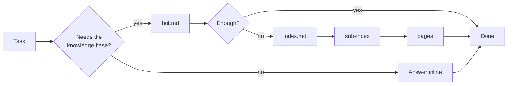

<div align="center">



<br>

# cheap-inference <sub>2.0.0</sub>

### Pay for the tokens that change the answer.

A tested, zero-dependency Python toolkit and a 14-chapter field guide for cutting what you spend on language models. Load less. Redo less. Check with code. Route cheap first. Fan out with summaries.

<br>

<a href="https://github.com/paulfxyz/cheap-inference/actions/workflows/ci.yml"></a>
<a href="LICENSE"></a>


<br><br>

[**Quick start**](#quick-start) &nbsp;·&nbsp; [**The five levers**](#the-five-levers) &nbsp;·&nbsp; [**Tools**](#the-tools) &nbsp;·&nbsp; [**Field guide**](#the-field-guide) &nbsp;·&nbsp; [**Prompts**](docs/11-prompt-library.md) &nbsp;·&nbsp; [**100 tips**](docs/12-tips-and-tweaks.md) &nbsp;·&nbsp; [**Receipts**](docs/14-claims-and-receipts.md)

</div>

<br>

## The short version

Most of what you pay a model for is not your question. It is the guide loaded in every session, the knowledge base opened for a question that never needed it, the 500 files re-read because nothing remembered they were done, the review pass a script could have done for free, and the premium model used to rename a file.

This repository attacks that waste with habits, templates and small Python tools. **None of the checks needs a model to run.** Every tool is a single, heavily commented file you can read in ten minutes.

> **One line to remember:** *if code can do it, never pay a model to do it.*

<br>

## Bold claims, with receipts

Every claim below has a command that checks it. Run them. If one fails for you, open an issue. Full list in [chapter 14](docs/14-claims-and-receipts.md).

<table>
<tr>
<td width="33%" valign="top">

### 0 tokens
The linter, budget checker, deduplicator, router, log compactor and cache simulator never call a model.

<sub>Receipt: read `tools/`. No network code.</sub>

</td>
<td width="33%" valign="top">

### 1 false quote, caught
A planted lie passes a model reviewer more often than you would think. A 10-rule script catches it in milliseconds.

<sub>Receipt: `kb.py --root examples/broken-kb lint`</sub>

</td>
<td width="33%" valign="top">

### 0 cost on quiet nights
Hash every source. When nothing changed, the nightly job exits before any model call.

<sub>Receipt: `kb.py status` prints nothing.</sub>

</td>
</tr>
<tr>
<td valign="top">

### 1 line, whole cache
One timestamp at the top of a prompt can zero your cache hit rate. Order is the discount.

<sub>Receipt: `python tools/cache_sim.py`</sub>

</td>
<td valign="top">

### Monthly, not once
Always-loaded files are billed on every session. The budget checker prints the monthly loading bill.

<sub>Receipt: `python tools/budget.py examples/budget.json`</sub>

</td>
<td valign="top">

### 0 dependencies
Python standard library only. Clone, run, read. Nothing to install, nothing to trust.

<sub>Receipt: imports in `tools/`.</sub>

</td>
</tr>
</table>

<div align="center">

</div>

<br>

## Quick start

```bash
git clone https://github.com/paulfxyz/cheap-inference.git
cd cheap-inference

python tools/tokens.py templates/AGENTS.md templates/hot.md        # what does my context weigh?
python tools/budget.py examples/budget.json                        # does it fit, and what is the monthly bill?
python tools/prompt_lint.py templates/AGENTS.md                    # filler, volatile lines, eager imports
python tools/kb.py --root examples/broken-kb lint                  # a lie, caught for free
python tools/router.py "deep research on every competitor"         # which rung of the ladder?
python tools/cache_sim.py                                          # why prompt order is a discount
python tools/session_budget.py --turns 60 --per-turn 700           # when to start a fresh session
python -m unittest discover -s tests -v                            # 30 tests
```

<details>
<summary><strong>What the linter prints on the broken example</strong></summary>

```
wiki/lonely.md: frontmatter lacks 'updated'
wiki/lonely.md: source raw/gone.md does not exist
wiki/lonely.md: unresolved TODO/FIXME
wiki/memex.md: broken link [[nonexistent-page]]
wiki/memex.md: QUOTE NOT IN SOURCE -> "The memex was first built in 1975" (raw/memex.md)
wiki/lonely.md: orphan (no inbound links)
wiki/memex.md: orphan (no inbound links)
lint: 7 problem(s) in 2 pages
```

</details>

<br>

## The five levers



| | Lever | In one sentence | Chapter | Tool |
| :-: | --- | --- | :-: | --- |
| 1 | **Load less** | Read a hot cache, then an index, then pages. Stop at the first tier that answers. | [2](docs/02-tiered-loading.md) | `budget.py` `tokens.py` |
| 2 | **Redo less** | Hash sources; process only NEW, CHANGED, DELETED. | [5](docs/05-incremental-ingest.md) | `kb.py status` |
| 3 | **Check with code** | Quotes, links, orphans, staleness: all verified by script. | [4](docs/04-deterministic-checks.md) | `kb.py lint` `dedup.py` |
| 4 | **Route cheap first** | Lowest rung that can do it; climb with a reason. | [6](docs/06-routing-ladder.md) | `router.py` `ladder_log.py` |
| 5 | **Fan out with summaries** | One cheap worker per source, three lines back, one fresh verifier. | [7](docs/07-fan-out.md) | prompts P21 to P24 |

<div align="center">

</div>

### 1. Load less

Add one sentence to every guide: *do not open the knowledge base for general questions.* Keep a hot cache under a dozen lines. Never import big files eagerly: an import costs as much as pasting the file in.

<div align="center">

</div>

### 2. Redo less

The manifest records which source became which pages, at which hash. Cost follows what changed, not how big the vault is.

<div align="center">

</div>

### 3. Check with code

A model reviewing its own work tends to agree with itself. A script cannot be talked out of a rule. Ten rules, zero tokens, exit code 2 that a hook can feed straight back to the model.

### 4. Route cheap first

<div align="center">

</div>

Rung 0 is an inline answer. Rung 5 is a premium model. The rule: **climb one rung at a time, and only when you can say what failed.** Explicit instructions always win.

### 5. Fan out with summaries

Forty documents in the main thread are paid for on every later turn. Forty workers returning three lines each are not.

<br>

## The tools

Thirteen single-file tools in [`tools/`](tools/). Standard library only. Every function documented. Every tool has tests.

| Tool | What it does for you | Tokens |
| --- | --- | :-: |
| [`kb.py`](tools/kb.py) | Incremental `status`, `done`, 10-rule `lint`, `index`, `stats`, `stale` for a model-written wiki | 0 |
| [`prompt_lint.py`](tools/prompt_lint.py) | Finds filler, volatile text at the top, eager imports, repeats, missing output limits | 0 |
| [`budget.py`](tools/budget.py) | Per-file and total budgets for always-loaded text, plus the monthly loading bill | 0 |
| [`tokens.py`](tools/tokens.py) | Token estimates for files and folders, optional exact count | 0 |
| [`usage_report.py`](tools/usage_report.py) | Ranks where tokens go from a usage log and gives one actionable hint | 0 |
| [`costcalc.py`](tools/costcalc.py) | Compares a workload across routes with cached-input and batch multipliers (your prices) | 0 |
| [`router.py`](tools/router.py) | Transparent, editable cheap-first router | 0 |
| [`ladder_log.py`](tools/ladder_log.py) | Learns the lowest rung that worked for each task kind and makes it the floor | 0 |
| [`cache_sim.py`](tools/cache_sim.py) | Shows how prompt order changes the cacheable share | 0 |
| [`session_budget.py`](tools/session_budget.py) | Models when splitting a long session beats continuing it | 0 |
| [`compact.py`](tools/compact.py) | Shrinks logs and tool output before they enter a context | 0 |
| [`chunker.py`](tools/chunker.py) | Splits giant Markdown into small linked pages ready for the wiki | 0 |
| [`dedup.py`](tools/dedup.py) | Near-duplicate page finder with shingles and Jaccard similarity | 0 |

<br>

## The field guide

| # | Chapter | You will learn |
| :-: | --- | --- |
| 1 | [Why context is the bill](docs/01-why-context-costs.md) | Three kinds of tokens, the multiplication problem, measure first |
| 2 | [Tiered loading](docs/02-tiered-loading.md) | Tiers, hot cache, sub-indexes, budgets, one shared knowledge base |
| 3 | [The knowledge-base pattern](docs/03-knowledge-base-pattern.md) | Layout, operations, page format, when not to build one |
| 4 | [Deterministic checks](docs/04-deterministic-checks.md) | Ten lint rules, hooks, keys not prompts, writing your own rule |
| 5 | [Incremental ingest](docs/05-incremental-ingest.md) | Manifest, loop, scheduled runs, bad-source defences |
| 6 | [The cheap-first ladder](docs/06-routing-ladder.md) | Six rungs, reasons to climb, overrides, pure-inference batches |
| 7 | [Cheap fan-out](docs/07-fan-out.md) | Workers, verifier, templates, injection safety |
| 8 | [Caching, ordering, batching](docs/08-caching-and-batching.md) | Prefix caching, prompt order, local result cache |
| 9 | [Failure modes](docs/09-failure-modes.md) | Dead zone, scale, over-pruning, security |
| 10 | [Checklist](docs/10-checklist.md) | Ten-minute, one-hour and weekly wins, red flags, glossary |
| 11 | [Prompt library](docs/11-prompt-library.md) | **42 copy-paste prompts** for setup, ingest, query, review, routing, fan-out, output shaping |
| 12 | [Tips and tweaks](docs/12-tips-and-tweaks.md) | **100 small changes**, each cheap to try and easy to undo |
| 13 | [Recipes](docs/13-recipes.md) | Ten end-to-end workflows combining the tools |
| 14 | [Claims and receipts](docs/14-claims-and-receipts.md) | Every bold claim with the command that checks it, and what we do not claim |

<br>

## Pick your starting point

<table>
<tr>
<td width="25%" valign="top">

**I have 10 minutes**

Run `prompt_lint.py` and `tokens.py` on your guide. Add the "when not to read" line. [Checklist](docs/10-checklist.md).

</td>
<td width="25%" valign="top">

**I run agents nightly**

Use [recipe 13.2](docs/13-recipes.md): `kb.py status`, exit if empty, ingest only what changed.

</td>
<td width="25%" valign="top">

**I pay a big bill**

Export usage, run `usage_report.py`, fix the top group. [Recipe 13.3](docs/13-recipes.md).

</td>
<td width="25%" valign="top">

**I want the theory**

Start at [chapter 1](docs/01-why-context-costs.md), end at [chapter 9](docs/09-failure-modes.md).

</td>
</tr>
</table>

<br>

## What is in this repo

```
cheap-inference/
├── README.md, CHANGELOG.md, VERSION
├── docs/            14 chapters + animated and static SVG illustrations (docs/images/)
├── tools/           13 stdlib-only Python tools
├── templates/       AGENTS.md, hot.md, ingest skill, post-edit and session-start hooks
├── examples/        sample-kb (clean), broken-kb (every error), budget and price tables
├── tests/           30 unit tests
└── .github/         CI on Python 3.10 and 3.12
```

<br>

## Honest limits

- Token counts are estimates (characters / 4, words x 1.33). Use your provider's counter for exact numbers.
- No real prices are shipped. `examples/prices.example.json` holds placeholders; fill in your own.
- The linter checks structure and quotes, not truth. A wrong source makes a faithfully wrong wiki.
- Below roughly 50 to 100 sources a wiki is not worth building. Chapter 9 lists where else this breaks.
- We do not promise a percentage saving. Measure yours with `usage_report.py` before and after.

## FAQ

<details>
<summary><strong>Does this work with any model or agent tool?</strong></summary>
<br>
Yes. The tools are plain Python over plain files. The templates are written for agent tools that read a guide file and support hooks, but the ideas apply to any setup.
</details>

<details>
<summary><strong>Will cutting context make answers worse?</strong></summary>
<br>
It can, if you trim blindly. The rules are built to cut waste, not substance: trim the always-loaded layer first, keep an escalation path, and never trim safety instructions. See chapter 9.
</details>

<details>
<summary><strong>Why not just use retrieval?</strong></summary>
<br>
Retrieval rediscovers knowledge on every question. A maintained wiki pays for synthesis once, at ingest. Below roughly 50 to 100 sources, retrieval wins; the guide explains the crossover.
</details>

<details>
<summary><strong>Where do I get prices?</strong></summary>
<br>
From your providers' current pricing pages. They change often, so none are hard-coded here.
</details>

## Contributing

Standard library only, commented generously, tested, and never inventing numbers. See [CONTRIBUTING.md](CONTRIBUTING.md). If a receipt fails on your data, open an issue with the command and its output.

## Licence

MIT. See [LICENSE](LICENSE).

<div align="center">

<br>

**Built by [Paul Fleury](https://github.com/paulfxyz) in Lisbon, with AI.**

<sub>If this saved you tokens, a star helps others find it.</sub>

</div>
