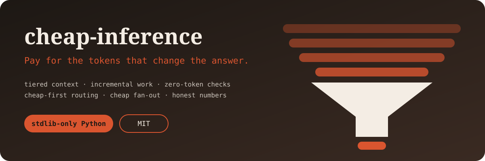
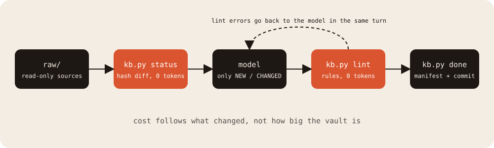
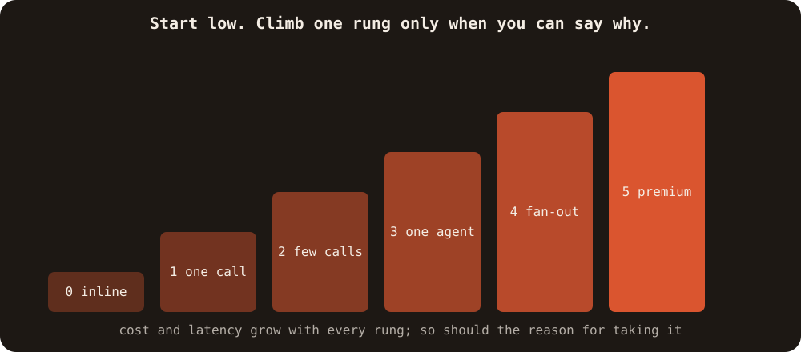

<div align="center">



<br><br>

**Pay for the tokens that change the answer.**

A practical, tested toolkit and field guide for cutting the cost of working with language models: load less, redo less, check with code, route cheap first.

<a href="https://github.com/paulfxyz/cheap-inference/actions/workflows/ci.yml"></a>
<a href="LICENSE"></a>


<br><br>

[The idea](#the-idea) · [Quick start](#quick-start) · [Field guide](docs/) · [Tools](#the-tools) · [Checklist](docs/10-checklist.md)

</div>

<details>
<summary><strong>Contents</strong></summary>

- [The idea](#the-idea)
- [At a glance](#at-a-glance)
- [Quick start](#quick-start)
- [The five levers](#the-five-levers)
- [The tools](#the-tools)
- [The field guide](#the-field-guide)
- [What is in this repo](#whats-in-this-repo)
- [Honest limits](#honest-limits)
- [Contributing](#contributing)
- [Licence](#licence)
- [Author](#author)

</details>

## The idea

Most of what you pay a language model for is not your question. It is the guide that is loaded in every session, the knowledge base opened for a question that never needed it, the 500 files re-read because nothing remembered they were done, the review pass a script could have done in a millisecond, and the premium model used to rename a file.

`cheap-inference` is a small set of habits, templates and standard-library Python tools that attack that waste directly. None of it needs a model to run. Everything is measured, tested and commented so you can read it, change it and trust it.

The core rule fits on one line: **load less, redo less, check with code, route cheap first, and fan out with summaries.**

## At a glance

| | |
| --- | --- |
| **0** | tokens spent by the linter, budget checker, deduplicator, router and cache simulator |
| **0** | third-party dependencies; Python 3.10+ standard library only |
| **5** | levers, each with a chapter, a template and a tool |
| **10** | doc chapters, written to teach, not to summarise |
| **10** | lint rules for a model-written knowledge base |
| **17** | unit tests, run in CI on two Python versions |
| **0** | invented prices: the cost calculator ships placeholders you replace |

## Quick start

```bash
git clone https://github.com/paulfxyz/cheap-inference.git
cd cheap-inference

# 1. How much does my always-loaded context cost?
python tools/tokens.py templates/AGENTS.md templates/hot.md
python tools/budget.py examples/budget.json

# 2. A clean knowledge base passes; a broken one is caught, for free
python tools/kb.py --root examples/sample-kb lint
python tools/kb.py --root examples/broken-kb lint

# 3. Which rung of the ladder does this task need?
python tools/router.py "deep research on every competitor"

# 4. Does my prompt order let a cache work?
python tools/cache_sim.py

# 5. Run the tests
python -m unittest discover -s tests -v
```

Expected output of step 2, second command (the planted false quote is caught without a single token):

```
wiki/lonely.md: frontmatter lacks 'updated'
wiki/lonely.md: source raw/gone.md does not exist
wiki/lonely.md: unresolved TODO/FIXME
wiki/memex.md: broken link [[nonexistent-page]]
wiki/memex.md: QUOTE NOT IN SOURCE -> "The memex was first built in 1975" (raw/memex.md)
wiki/lonely.md: orphan (no inbound links)
wiki/memex.md: orphan (no inbound links)
lint: 7 problem(s) in 2 pages
```

## The five levers

<div align="center">

</div>

### 1. Load less: tiered context

Read a short hot cache first, then an index, then a domain sub-index, then specific pages, and stop at the first tier that answers. Add one sentence to every guide: do not open the knowledge base for general questions. Never import big files eagerly. [Chapter 2](docs/02-tiered-loading.md).

### 2. Redo less: incremental work

Hash every source. Process only NEW, CHANGED and DELETED files. When nothing changed, the nightly job costs nothing. [Chapter 5](docs/05-incremental-ingest.md).

<div align="center">

</div>

### 3. Check with code

A script verifies that every quoted claim exists word for word in its source, that links resolve, that no page is orphaned or stale. A model reviewing its own work agrees with itself; a script cannot be talked out of a rule. [Chapter 4](docs/04-deterministic-checks.md).

### 4. Route cheap first

<div align="center">

</div>

Start on the lowest rung that can plausibly do the job. Climb one rung at a time, only with a reason you can state. Explicit instructions always win. [Chapter 6](docs/06-routing-ladder.md).

### 5. Fan out with summaries

One cheap worker per source, each returning three lines, then one fresh-context verifier. The main thread never sees the documents. [Chapter 7](docs/07-fan-out.md).

Bonus: order prompts stable-first so provider caching can work, and batch anything nobody is waiting for. [Chapter 8](docs/08-caching-and-batching.md).

## The tools

All tools are single files in [`tools/`](tools/), standard library only, and heavily commented.

| Tool | What it does | Tokens used |
| --- | --- | --- |
| [`kb.py`](tools/kb.py) | Manifest-based incremental status, `done`, 10-rule `lint`, `index`, `stats`, `stale` | 0 |
| [`tokens.py`](tools/tokens.py) | Estimate token cost of files and folders | 0 |
| [`budget.py`](tools/budget.py) | Check always-loaded files against per-file and total budgets, with a monthly loading bill | 0 |
| [`costcalc.py`](tools/costcalc.py) | Compare a workload across routes, with cached-input and batch multipliers (your prices) | 0 |
| [`router.py`](tools/router.py) | Transparent rule-based cheap-first router | 0 |
| [`dedup.py`](tools/dedup.py) | Near-duplicate page finder using shingles and Jaccard similarity | 0 |
| [`cache_sim.py`](tools/cache_sim.py) | Shows how prompt order changes the cacheable share | 0 |

## The field guide

| # | Chapter | You will learn |
| --- | --- | --- |
| 1 | [Why context is the bill](docs/01-why-context-costs.md) | The three kinds of tokens, the multiplication problem, how to measure first |
| 2 | [Tiered loading](docs/02-tiered-loading.md) | Tiers, hot cache, sub-indexes, budgets, one shared knowledge base |
| 3 | [The knowledge-base pattern](docs/03-knowledge-base-pattern.md) | Layout, operations, page format, prompts, when not to build one |
| 4 | [Deterministic checks](docs/04-deterministic-checks.md) | Ten lint rules, hooks, keys not prompts, writing your own rule |
| 5 | [Incremental ingest](docs/05-incremental-ingest.md) | Manifest, loop, scheduled runs, bad-source defences |
| 6 | [The cheap-first ladder](docs/06-routing-ladder.md) | Six rungs, escalation reasons, overrides, pure-inference batches |
| 7 | [Cheap fan-out](docs/07-fan-out.md) | Workers, verifier, templates, injection safety |
| 8 | [Caching, ordering, batching](docs/08-caching-and-batching.md) | Prefix caching, prompt order, local result cache |
| 9 | [Failure modes](docs/09-failure-modes.md) | Dead zone, scale, bad sources, over-pruning, security |
| 10 | [Checklist](docs/10-checklist.md) | Ten-minute, one-hour and weekly wins, red flags, glossary |

## What is in this repo

```
cheap-inference/
├── README.md
├── docs/                 ten chapters plus SVG illustrations in docs/images/
├── tools/                kb.py tokens.py budget.py costcalc.py router.py dedup.py cache_sim.py
├── templates/            AGENTS.md, hot.md, ingest skill, post-edit and session-start hooks
├── examples/             sample-kb (clean), broken-kb (all the errors), budget and price tables
├── tests/                17 unit tests
└── .github/workflows/    CI on Python 3.10 and 3.12
```

## Honest limits

- Token counts are estimates (characters / 4, words x 1.33). Use your provider's counter for exact numbers.
- No real prices are shipped. `examples/prices.example.json` contains placeholders; fill it in yourself.
- The linter checks structure and quotes, not truth. A wrong source makes a faithfully wrong wiki.
- Below roughly 50 to 100 sources a wiki is not worth building. Chapter 9 explains where else this breaks.

## Contributing

Standard-library only, commented generously, tested, and never inventing numbers. See [CONTRIBUTING.md](CONTRIBUTING.md).

## Licence

MIT. See [LICENSE](LICENSE).

## Author

Built by [Paul Fleury](https://github.com/paulfxyz) in Lisbon, with AI.
