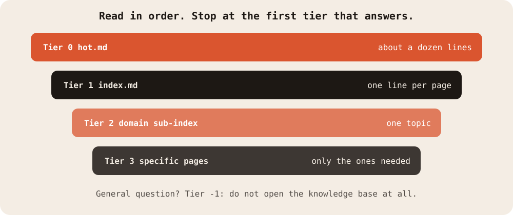

# 2. Tiered loading



> Principle: load the least text that can answer the question, and stop as soon as it does.

## 2.1 The tiers

| Tier | File | Size target | Purpose |
| --- | --- | --- | --- |
| -1 | (nothing) | 0 | General questions never touch the knowledge base |
| 0 | `wiki/hot.md` | about a dozen lines | What you are working on, what changed last, open questions |
| 1 | `wiki/index.md` | one line per page | A map: which page covers what |
| 2 | domain sub-index | one topic | Only when the index is too large to scan |
| 3 | specific pages | as needed | The detail itself |

A request walks down the tiers and stops at the first one that answers it. Most requests should end at tier -1 or 0.

## 2.2 The "when not to read" line

The single cheapest instruction in this repository is one sentence in your project guide:

```markdown
Do NOT read the knowledge base for general questions (definitions, generic code, formatting).
```

Without it, an agent with access to a knowledge base tends to consult it by default. With it, the common case costs nothing. Put it directly under the path of the knowledge base so it is read together with the path.

## 2.3 Never import big files eagerly

Many agent tools let a guide include another file with an import-style reference. Be careful: an import is expanded when the session starts, so it costs exactly as much as pasting the file in. That is fine for a 10-line hot cache and wasteful for a 500-line index.

| Pattern | Cost |
| --- | --- |
| `@wiki/index.md` (eager import) | Paid at the start of every session |
| "Read wiki/index.md if the hot cache is not enough" | Paid only when needed |

Prefer the second.

## 2.4 The hot cache

`hot.md` is a cache in the true sense: small, recent, and cheap to rewrite. Rules that keep it that way:

1. Rewrite it; do not append forever. A cache that only grows is an archive.
2. Cap it. `tools/kb.py lint` fails if `hot.md` exceeds 25 non-empty lines (configurable with `--hot-max-lines`).
3. Content: current focus, last change, open questions, one "do not forget". Nothing else.

Template: [`templates/hot.md`](../templates/hot.md).

## 2.5 One shared knowledge base, many projects

Instead of building a separate wiki per project, build one and point every project at it. In each project guide add the four-step reading order from section 2.1 and the "when not to read" line. Benefits: knowledge accumulates in one place, nothing is duplicated, and each project only pays for the tiers it opens.

Risk: a shared base with no discipline becomes a dumping ground. Use sub-indexes per domain once the main index passes a few hundred lines.

## 2.6 Sub-indexes

When `index.md` gets long enough that scanning it is itself expensive, split it:

```
wiki/index.md              -> lists domains only (10-20 lines)
wiki/domains/seo.md        -> lists pages about SEO
wiki/domains/support.md    -> lists pages about support
```

The model reads the top index, picks a domain, reads that sub-index, then opens pages. Three small reads beat one large one.

## 2.7 Budgeting always-loaded files

Always-loaded files are the ones you pay for in every session. Put them under an explicit budget and check it:

```bash
python tools/budget.py examples/budget.json
```

Exit code 2 means something is over budget, so the same command works in CI or a pre-commit hook. Suggested starting limits: guide 700 tokens, hot cache 250, total always-loaded 1,500. Adjust to your needs, but write the numbers down; a budget nobody wrote down is not a budget.

## 2.8 Memory summaries and skill descriptions

Two other things are loaded in every session and are easy to forget:

- **Memory summaries.** Keep them to what is durable and general. Detailed facts belong in pages that are opened on demand.
- **Skill or tool descriptions.** A skill's description is read to decide whether to load it. Make it short and specific; the body is only paid for when the skill is used.

## 2.9 Tips and tweaks

- Name files for what they contain (`tax-policy.md`, never `note-12.md`) so an index line is enough to decide whether to open a page.
- Put the answer-bearing sentence first in each page. If the model stops reading early, it still got the main point.
- Split any page over about 1,500 tokens (lint rule R9). Smaller pages mean smaller reads.
- Prefer a table to prose for reference data: it is shorter and easier to scan.
- Keep the index line to one line. If you need two, the page title is not doing its job.
