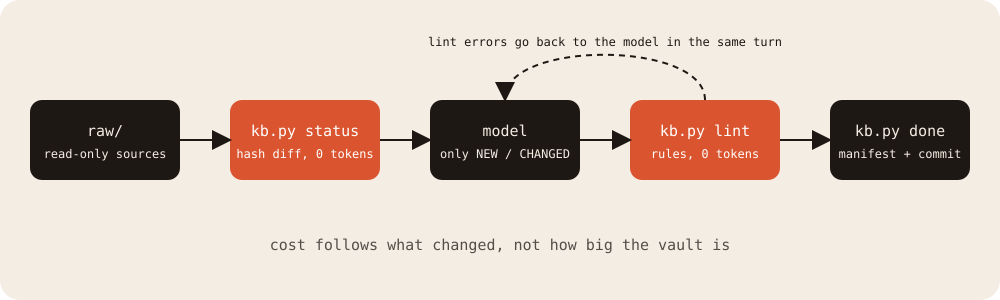

# 5. Incremental ingest



> Principle: cost should follow what changed, not the size of the vault.

## 5.1 The failure it prevents

A naive nightly job says "re-read everything and update the wiki". With 500 sources that is 500 reads every night, even if one file changed. Cost grows with the size of the vault, and so does the chance of the model rewording stable pages for no reason.

## 5.2 The manifest

`.brain/manifest.json` records, for each raw file, a short content hash, the wiki pages it was ingested into, and the date:

```json
{
  "raw/memex.md": {
    "sha": "9f2c1a7e4b3d6a10",
    "pages": ["wiki/memex.md", "wiki/associative-trails.md"],
    "ingested": "2026-11-26"
  }
}
```

`kb.py status` compares the current files with this record and prints only the work to do:

```
NEW raw/new-article.md
CHANGED raw/memex.md
DELETED raw/old-note.md
```

If the output is empty, the correct cost of tonight's job is zero.

## 5.3 The loop

1. `python tools/kb.py status` - get the work list. Work only on those files.
2. The model reads each file fully, creates or updates pages, writes quote lines, links related pages.
3. `python tools/kb.py lint --skip-stale` - repeat until it exits 0. (A plain `lint` cannot pass yet for a CHANGED file: rule R7 compares the raw file with the manifest, and `done` has not updated the manifest. A multi-model review caught this sequencing bug.)
4. `python tools/kb.py done raw/x.md wiki/a.md wiki/b.md` - record the result.
5. `python tools/kb.py index` - regenerate the index, then run a strict `python tools/kb.py lint`.
6. `git add wiki/ .brain/ && git commit -m "ingest x"` - stage only what ingest owns, never `git add -A`, which can sweep in unrelated files or secrets. The diff shows exactly what changed in your knowledge.

The template skill [`templates/ingest-skill.md`](../templates/ingest-skill.md) turns this into a single command.

## 5.4 Handling CHANGED and DELETED

- **CHANGED**: the pages listed in the manifest for that file are now stale. The model should re-read the source and update those pages, not create new ones.
- **DELETED**: decide deliberately. Either remove the pages that relied only on that source, or keep them and mark the source as archived. Silent deletion leaves pages with dangling `sources`, which lint rule R2 will catch.

## 5.5 Scheduled runs

For unattended runs, use a non-interactive invocation of your agent with a narrow tool allow-list: read, edit wiki, run `kb.py`, commit. Notes from experience:

- Allow-list narrowly: `python3 tools/kb.py *` is a pattern, not an exact command, and broad staging patterns can commit unrelated files. Prefer explicit paths (`git add wiki/ .brain/`).
- Make the first step `status`. If it prints nothing, exit without calling the model at all. A small shell guard does this, and it must tell "nothing changed" apart from "status failed":

```bash
#!/bin/bash
set -eo pipefail                      # a failing status must not look like a quiet night
out=$(python3 tools/kb.py status 2>/dev/null) || { echo "status failed" >&2; exit 1; }
[ -z "$out" ] && exit 0               # genuinely nothing changed: spend nothing
# ...otherwise start the agent run here...
```

- After updating your agent tool, re-check that the scheduled run still loads your skills and guide; defaults for non-interactive mode can change between releases.

## 5.6 Large batches

When 40 sources arrive at once, do not read them all in the main thread. See [chapter 7](07-fan-out.md): one worker per source, each returning a short summary, then one fresh-context verifier.

## 5.7 Bad sources spread

One wrong note in a notes app is one wrong note. One wrong source in a compiled wiki has already touched 10 to 15 pages. Defences, in order of strength:

1. Read-only `raw/` enforced by configuration.
2. The quote check (R6), which ties every claim to a source line.
3. The manifest, which tells you exactly which pages a source touched, so you can fix or revert them together.
4. The git diff after each ingest.

## 5.8 Tips and tweaks

- Hash content, not timestamps. A file copied or touched without changes should not trigger work.
- Ingest in small batches and commit each. A bad batch is one `git revert` away.
- Keep source files small and single-topic. A 200-page PDF should be split before ingest, or the model will summarise it vaguely.
- Record the ingest date in the manifest; it makes later audits of "when did we learn this" trivial.
