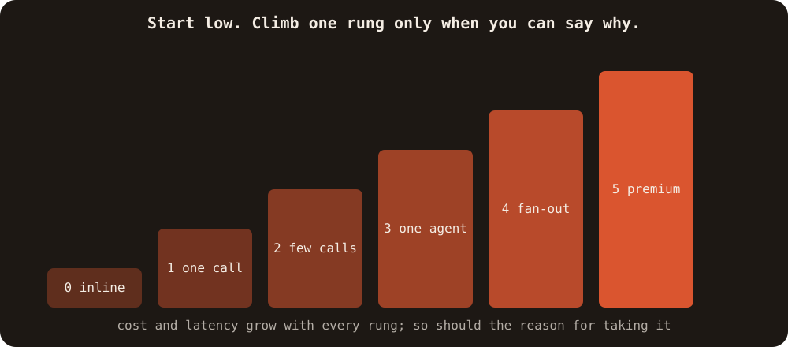

# 6. The cheap-first ladder



> Principle: start at the lowest rung that can plausibly do the job, and climb one rung at a time only when you can say why.

## 6.1 The rungs

| Rung | Route | Use for |
| --- | --- | --- |
| 0 | Answer inline, no tools | Definitions, formatting, small code, rewording |
| 1 | One search or one fetch | A single fact, one page |
| 2 | A few parallel calls, inline | Comparing two or three things, cross-checking a claim |
| 3 | One focused agent | A short brief, one deliverable that needs iteration |
| 4 | Fan-out or deep research | Many entities or many sources, with citations |
| 5 | Premium model, high effort | You asked for top quality, a lower rung failed, or the stakes are high |

## 6.2 The rule of thumb

If you cannot say why the current rung failed, do not climb. "It might be better" is not a reason. "The answer was shallow and missed X" is.

## 6.3 What counts as a reason to climb

- The result was wrong or shallow in a way you can name.
- The task is bigger than the rung can hold (more items than fit in one thread).
- The deliverable is high-stakes (legal, investor-facing, safety).
- The user explicitly asked for more depth or a particular model.

## 6.4 Explicit instructions always win

A cost policy only fills in the blanks. If a person or a project specifies a model, depth, provider or route, follow it exactly. The ladder is a default, never an override. It also must not reduce requested quality: if someone asks for a deep research report, spend what is needed.

## 6.5 Reading feedback as the escalation signal

| Signal | Adjustment |
| --- | --- |
| Accepts the result | Stay on this rung for similar work |
| "Go deeper", "more sources" | Climb one rung |
| "That is wrong", re-asks the same question | Climb one rung and widen the search or cross-check |
| Names a model or route | Use exactly that |
| Same kind of task repeated | Keep the rung that worked; if it was upgraded once, keep the upgrade |

## 6.6 A transparent router

`tools/router.py` is a rule-based router, deliberately simple so you can read and change every rule:

```bash
$ python tools/router.py "what is a hash"
rung 0: no escalation signal; answer inline

$ python tools/router.py "deep research on every competitor"
rung 4: wide or deep multi-source work

$ python tools/router.py "look up the price" --items 120
rung 4: single lookup; 120 items => fan-out
```

It costs zero tokens and is meant as a template for your own policy. Edit the `RULES` list.

## 6.7 Effort and model overrides

Defaults are usually tuned already. Overriding the model or reasoning effort without a reason tends to cost more for no gain. Before overriding, ask:

1. Did anyone ask for it?
2. Did a lower setting actually fail?
3. Is the deliverable high-stakes?

If all three are no, use the default.

## 6.8 Pure-inference batches

If the work is only text in, text out (summarising, translating, classifying, extracting, generating code) and does not need tools, a large batch can be routed to whichever provider is cheapest for that job. The conditions to consider this:

1. No dependency on search, connectors, memory or media.
2. Heavy volume: many long generations or a bulk multilingual pass.
3. A cheaper model plausibly does the job well.

Offer the cheaper route once, before starting, then respect the answer. Use `tools/costcalc.py` to make the comparison concrete with your own prices.

## 6.9 Tips and tweaks

- Cheap models are often best at the boring middle: classification, extraction, reformatting. Reserve the expensive model for judgement.
- Draft with a cheap model, review the diff with a better one only when the stakes justify it.
- Cap output length. Output is usually the most expensive token, and models over-explain by default.
- Ask for a structured format (a table, JSON) when you will process the result with code; it is shorter and cheaper to parse.
- Avoid generating video or other expensive media without confirming first.
